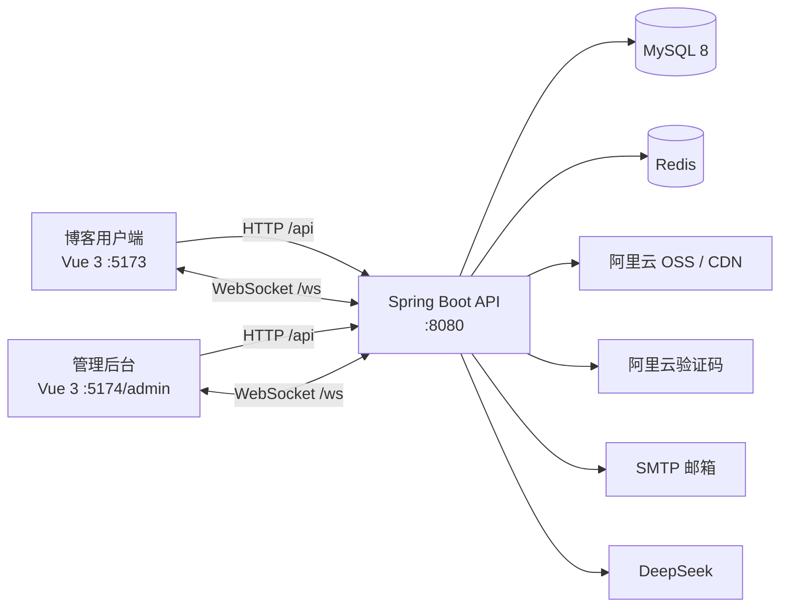

<h1 align="center">Yesir Blog</h1>

<p align="center">基于 Spring Boot 3 与 Vue 3 的前后端分离个人博客系统</p>

<p align="center">
  
  
  
  
  
  
  
</p>

## 项目简介

Yesir Blog 是一套个人博客全栈项目，仓库包含面向访客的博客前台、面向运营人员的管理后台，以及统一提供 API 和实时通信能力的 Spring Boot 服务。

- `vue-blog-personal`：博客用户端，负责内容浏览、账号中心、评论互动、友链、音乐和 WebSocket 通知。
- `vue-blog-management`：博客管理端，负责内容运营、评论审核、友链和音乐管理、权限管理、运营报表和操作日志。
- `blog-personal-project`：Maven 多模块后端，包含公共模型模块和业务服务模块。

> 当前状态：文章、日常、评论、留言、点赞、友链、RSS、音乐、账号安全和后台权限等主要功能已经接入。文章发布时会调用 DeepSeek 自动生成摘要，失败时回退到本地截取。由于鉴权和数据接口仍在完善，管理端 AI 助手流式接口与 AI 周报基础数据接口当前处于临时停用状态。

## 核心功能

### 博客用户端

- **首页展示**：公告、热门文章、分类、标签、文章日历、站点统计、博主信息和站点运行时长。
- **文章阅读**：分页与关键词搜索、列表布局切换、文章详情、上一篇/下一篇、图片预览、点赞、评论和回复。
- **日常内容**：日常列表与详情，支持文字、图片、文件附件和视频附件展示。
- **留言板**：分页浏览、发布留言、回复和点赞。
- **账号体系**：邮箱验证码注册、滑块验证、风险登录校验、可信设备、记住登录、退出登录、忘记密码、个人资料、头像和密码修改。
- **通知中心**：评论、点赞和友链事件通过 WebSocket 推送，支持在线人数与未读消息提示。
- **RSS 订阅**：支持订阅、退订、订阅数统计和新文章邮件通知。
- **友链功能**：展示已通过友链、提交申请、按邮箱查询申请状态和催促审核。
- **个性化体验**：明暗主题、自定义背景、响应式布局、返回顶部、音乐播放器和移动端菜单。
- **站点信息**：备案信息、站点公告、个人博客信息和运行统计。

### 管理后台

- **数据看板**：汇总访问、文章、日常、评论、用户和友链数据，展示趋势、分布和排行榜。
- **内容管理**：文章与日常的富文本编辑、图片/视频/文件上传、分类标签、状态切换、置顶、定时发布、预览和批量操作。
- **互动管理**：文章评论、日常评论和留言的筛选、回复、置顶、隐藏、删除与回收站恢复。
- **用户与权限**：用户、角色、菜单和按钮权限管理，支持动态路由、接口权限和角色授权。
- **友链与音乐**：友链审核和状态管理，音乐信息、封面和音频管理，并支持后台试听。
- **站点配置**：公告、备案、个人博客信息、网站设置和 RSS 配置。
- **通知与日志**：WebSocket 通知中心、未读统计和管理端在线人数；操作日志自动记录增删改操作。
- **回收站**：文章、日常、评论、分类、标签、用户、角色和菜单等数据的恢复与彻底删除。
- **报表导出**：作品、评论、用户和友链的指标、趋势、分布和排行榜，支持 Excel 导出。
- **AI 能力**：文章自动摘要仍在使用；AI 助手和 AI 周报当前临时停用，其他 AI 接口尚未全部接入管理端界面。

### 后端服务

- Spring Security + JWT 无状态认证；用户端 Access Token 存放在 Pinia 内存，Refresh Token 使用 HttpOnly Cookie。
- Refresh Token Redis 白名单、令牌轮换、改密/重置密码/禁用账号后的凭证失效。
- 基于用户、角色、菜单和权限标识的 RBAC 权限模型。
- MyBatis、MySQL、PageHelper 和 Redis 数据访问与缓存。
- 阿里云 OSS 文件上传，可选配置自定义 CDN 域名。
- 阿里云滑块验证码、邮箱验证码、风险登录和可信设备校验。
- WebSocket 实时通知、在线统计和定时发布任务。
- 文章正文使用 Jsoup 白名单清洗，评论等纯文本字段按文本处理，前端 `v-html` 输出前再次过滤。
- 上传接口限制扩展名、文件大小，并对图片进行真实格式校验。
- Spring AI 对接 DeepSeek，提供摘要、文章生成、润色、标题、SEO、日志分析和评论回复等能力。
- 统一响应、全局异常处理、参数校验、操作日志和 Logback 文件日志。

## 系统架构



## 技术栈

| 分层 | 主要技术 |
| --- | --- |
| 博客用户端 | Vue 3.5、Vite 3、Vue Router、Pinia、Element Plus、Axios、WangEditor、ECharts |
| 管理后台 | Vue 3.5、Vite 3、Vue Router、Pinia、Element Plus、Axios、WangEditor、ECharts |
| 后端框架 | Java 17、Spring Boot 3.3.8、Spring Security、Spring WebSocket、Spring Scheduling |
| 数据访问 | MySQL 8、MyBatis 3.0.5、PageHelper、Redis、Lettuce |
| 认证与安全 | JWT、HttpOnly Refresh Cookie、Jsoup HTML 白名单、`xss` 前端过滤、文件上传校验 |
| 外部能力 | Spring AI 1.0.0-M7、DeepSeek、阿里云 OSS、阿里云验证码、SMTP、Apache POI |
| 其他 | Fastjson 2.0.66、Lombok、Hutool、Font Awesome、Lucide |

## 目录结构

```text
blog-personal/
|-- vue-blog-personal/                  # 博客用户端
|   |-- src/api/                        # 用户端接口封装
|   |-- src/components/                 # 公共组件和登录组件
|   |-- src/router/                     # 路由与登录态恢复
|   |-- src/store/                      # Pinia 用户状态
|   `-- src/views/                      # 页面视图
|-- vue-blog-management/                # 管理后台
|   |-- src/api/                        # 管理端接口封装
|   |-- src/components/                 # 公共组件
|   |-- src/router/                     # 动态权限路由
|   |-- src/stores/                     # Pinia 用户和权限状态
|   `-- src/views/                      # 业务页面
|-- blog-personal-project/              # Spring Boot 后端
|   |-- blog-common/                    # 实体、DTO/VO、配置属性、工具类
|   `-- blog-server/                    # Controller、Service、Mapper 和配置
|       `-- src/main/resources/
|           |-- database/blogyesir.sql  # 数据库初始化模板
|           `-- *.yml.template          # 配置模板
|-- LICENSE                             # 项目许可证
`-- login-template-LICENSE              # 登录模板第三方许可证
```

## 环境要求

| 环境 | 建议版本 |
| --- | --- |
| JDK | 17 |
| Maven | 3.8+ |
| Node.js | 18+ |
| npm | 9+ |
| MySQL | 8.0 |
| Redis | 7.x |

阿里云 OSS、阿里云验证码、DeepSeek 和 SMTP 属于外部服务。只浏览已有公开内容时可以暂不配置部分外部服务，但上传、验证码、邮件和 AI 功能会受到影响。

## 快速开始

### 1. 获取项目

```bash
git clone https://github.com/tiggeryjl/blog-personal.git
cd blog-personal
```

### 2. 初始化数据库

数据库脚本位于：

[`blog-personal-project/blog-server/src/main/resources/database/blogyesir.sql`](./blog-personal-project/blog-server/src/main/resources/database/blogyesir.sql)

脚本会创建并使用 `blog` 数据库，包含表结构、后台菜单权限、超级管理员角色和默认管理员账号，不包含文章、评论、日常等测试数据。

> 脚本包含 `DROP TABLE IF EXISTS`，只能用于空库或可丢弃的开发库。执行前请备份已有数据。

默认管理员账号：

| 账号 | 密码 | 角色 |
| --- | --- | --- |
| `admin` | `123456` | 超级管理员 |

首次登录后请立即修改默认密码。

### 3. 创建本地配置文件

仓库只提交 `.template` 配置文件，真实配置已被 `.gitignore` 排除。

PowerShell：

```powershell
Set-Location blog-personal-project/blog-server/src/main/resources
Copy-Item application.yml.template application.yml
Copy-Item application-dev.yml.template application-dev.yml
```

Bash：

```bash
cd blog-personal-project/blog-server/src/main/resources
cp application.yml.template application.yml
cp application-dev.yml.template application-dev.yml
```

生产环境使用：

```text
application-prod.yml.template -> application-prod.yml
```

请勿将填写真实密码、AccessKey 或 API Key 的本地配置提交到仓库。

### 4. 配置基础服务

至少需要修改：

- `application-dev.yml` 中的 MySQL 地址、库名、用户名和密码。
- `application-dev.yml` 中的 Redis 地址、密码和数据库编号。
- `application.yml` 中的 JWT 密钥。
- `application.yml` 中的 OSS `bucket-name`、`endpoint`、`region` 和验证码 `scene-id`。
- 发件邮箱和 DeepSeek 密钥。

常用环境变量：

| 变量 | 是否必需 | 用途 |
| --- | --- | --- |
| `OSS_ACCESS_KEY_ID` | 上传/验证码必需 | 阿里云 AccessKey ID |
| `OSS_ACCESS_KEY_SECRET` | 上传/验证码必需 | 阿里云 AccessKey Secret |
| `DEEPSEEK_API_KEY` | AI 功能需要 | DeepSeek API Key |
| `MAIL_HOST` | 邮件功能需要 | SMTP 服务器，默认 `smtp.qq.com` |
| `MAIL_PORT` | 否 | SMTP 端口，默认 `465` |
| `MAIL_USERNAME` | 邮件功能需要 | 发件邮箱 |
| `MAIL_PASSWORD` | 邮件功能需要 | SMTP 授权码 |
| `MAIL_ENABLED` | 否 | 是否启用邮件发送，默认 `true` |
| `RSS_SITE_URL` | 建议 | RSS 和新文章通知使用的站点地址 |
| `SPRING_PROFILES_ACTIVE` | 否 | 运行环境，默认 `dev` |

PowerShell 示例：

```powershell
$env:OSS_ACCESS_KEY_ID = "your-access-key-id"
$env:OSS_ACCESS_KEY_SECRET = "your-access-key-secret"
$env:DEEPSEEK_API_KEY = "your-deepseek-api-key"
$env:MAIL_USERNAME = "your-mail@example.com"
$env:MAIL_PASSWORD = "your-smtp-token"
$env:RSS_SITE_URL = "https://your-domain.com"
```

Bash 示例：

```bash
export OSS_ACCESS_KEY_ID="your-access-key-id"
export OSS_ACCESS_KEY_SECRET="your-access-key-secret"
export DEEPSEEK_API_KEY="your-deepseek-api-key"
export MAIL_USERNAME="your-mail@example.com"
export MAIL_PASSWORD="your-smtp-token"
export RSS_SITE_URL="https://your-domain.com"
```

OSS 可选配置：

```yaml
blog:
  alioss:
    cdn-domain: https://cdn.example.com
```

配置 CDN 后，新上传文件返回 CDN 地址；未配置时回退到 OSS Bucket 地址。新文件路径格式为 `img/yyyy/MM/dd/文件名`，已有文件地址不会自动修改。

### 5. 启动后端

```bash
cd blog-personal-project
mvn clean package -Dmaven.test.skip=true
java -jar blog-server/target/blog-server-0.0.1-SNAPSHOT.jar
```

开发环境默认接口地址：`http://localhost:8080`。

日志配置位于 `blog-server/src/main/resources/logback-spring.xml`，运行日志默认写入应用工作目录下的 `logs/`。

### 6. 启动博客用户端

```bash
cd vue-blog-personal
npm ci
npm run dev
```

访问：<http://localhost:5173>

### 7. 启动管理后台

```bash
cd vue-blog-management
npm ci
npm run dev
```

管理端 Vite `base` 和 Vue Router 均使用 `/admin/`，开发访问地址为：

<http://localhost:5174/admin/>

登录页：<http://localhost:5174/admin/login>

如果依赖文件尚未生成或 `npm ci` 不可用，可以先在对应前端目录执行 `npm install`。

## 配置说明

### 后端配置文件

| 文件 | 说明 |
| --- | --- |
| `application.yml` | 公共配置、JWT、OSS/CDN、AI、RSS 和邮件配置 |
| `application-dev.yml` | 开发环境端口、MySQL、Redis 和日志级别 |
| `application-prod.yml` | 生产环境端口、MySQL、Redis 和日志级别 |

仓库只跟踪对应的 `.template` 文件。Spring Boot 配置还可通过环境变量覆盖，例如：

```text
SPRING_DATASOURCE_URL
SPRING_DATASOURCE_USERNAME
SPRING_DATASOURCE_PASSWORD
SPRING_DATA_REDIS_HOST
SPRING_DATA_REDIS_PORT
SPRING_DATA_REDIS_PASSWORD
SPRING_DATA_REDIS_DATABASE
SERVER_PORT
```

### 前端开发代理

两个 Vite 开发服务器均配置：

- `/api` 代理到 `http://localhost:8080`，并移除 `/api` 前缀。
- `/ws` 代理到 `http://localhost:8080`，启用 WebSocket 转发。

管理端 WebSocket 地址可通过 `VITE_WS_URL` 覆盖；用户端地址可通过 `VITE_USER_NOTICE_WS_URL` 覆盖。

## 构建与部署

### 构建

```bash
cd vue-blog-personal
npm ci
npm run build
```

```bash
cd vue-blog-management
npm ci
npm run build
```

```bash
cd blog-personal-project
mvn clean package -Dmaven.test.skip=true
```

两个前端产物位于各自的 `dist/`，后端 JAR 位于 `blog-personal-project/blog-server/target/`。

### Nginx 反向代理

- 用户端部署在根路径 `/`。
- 管理端当前固定使用 `/admin/`，Nginx 需要将 `/admin/` 指向管理端 `dist/`，并将未知子路径回退到 `/admin/index.html`。
- `/api/*` 转发到后端并移除 `/api` 前缀。
- `/ws/*` 转发到后端，保留 `/ws` 路径并设置 WebSocket Upgrade 请求头。
- 两个前端都使用 History 路由，刷新深层页面时必须回退到对应的 `index.html`。
- OSS/CDN 域名、阿里云验证码和 SMTP 需要允许浏览器或后端访问。

生产环境注意事项：

- Refresh Token Cookie 已启用 `Secure`，生产必须使用 HTTPS。
- 通过 HTTP 和局域网 IP 调试时，浏览器可能拒绝保存 Refresh Cookie；本地开发建议使用 `localhost`。
- 生产环境必须替换 JWT 密钥、数据库密码、Redis 密码、AccessKey、邮箱授权码和默认管理员密码。
- `application-prod.yml.template` 默认端口为 `80`，可通过 `SERVER_PORT` 覆盖。
- 建议补充 CSP、HSTS、`X-Content-Type-Options`、`Referrer-Policy` 等安全响应头。
- 建议对所有可跳转 URL 增加后端 `http/https` 协议白名单校验。

仓库当前未包含 Dockerfile、Docker Compose、Nginx 或 CI/CD 配置文件，需要按实际服务器环境补充。

## 已知限制

- 管理端 AI 助手 `/AiChat/ai/stream-chat` 当前临时返回空结果，界面暂时无法正常对话。
- `/admin/report/weeklyData` 当前暂时返回空数据，AI 周报无法生成。
- 除文章自动摘要外，部分 AI 写作、润色、标题、SEO、日志分析和评论建议接口已经存在，但尚未接入前端。
- 自动摘要与文章保存同步执行。外部 AI 响应较慢时，文章保存耗时会增加；失败后会使用本地摘要。

## 第三方开源说明

博客用户端登录页面基于以下开源项目修改：

| 项目 | 说明 |
| --- | --- |
| 原仓库 | <https://gitee.com/niumg9527/login-animation> |
| 作者 | niumg9527 |
| 协议 | MIT License |
| 使用文件 | `LoginPage.vue`、`AnimatedCharacters.vue` 及其子组件 |
| 修改内容 | 新增注册、邮箱验证码和登录风险验证，并适配本项目的认证逻辑 |
| 原始协议 | [login-template-LICENSE](./login-template-LICENSE) |

## License

本项目基于 [MIT License](./LICENSE) 开源。第三方组件仍遵循各自的许可证。
